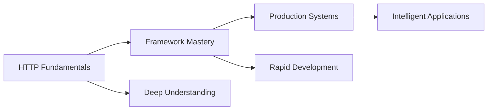
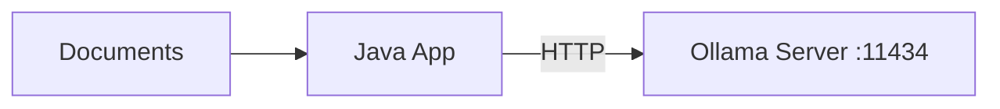
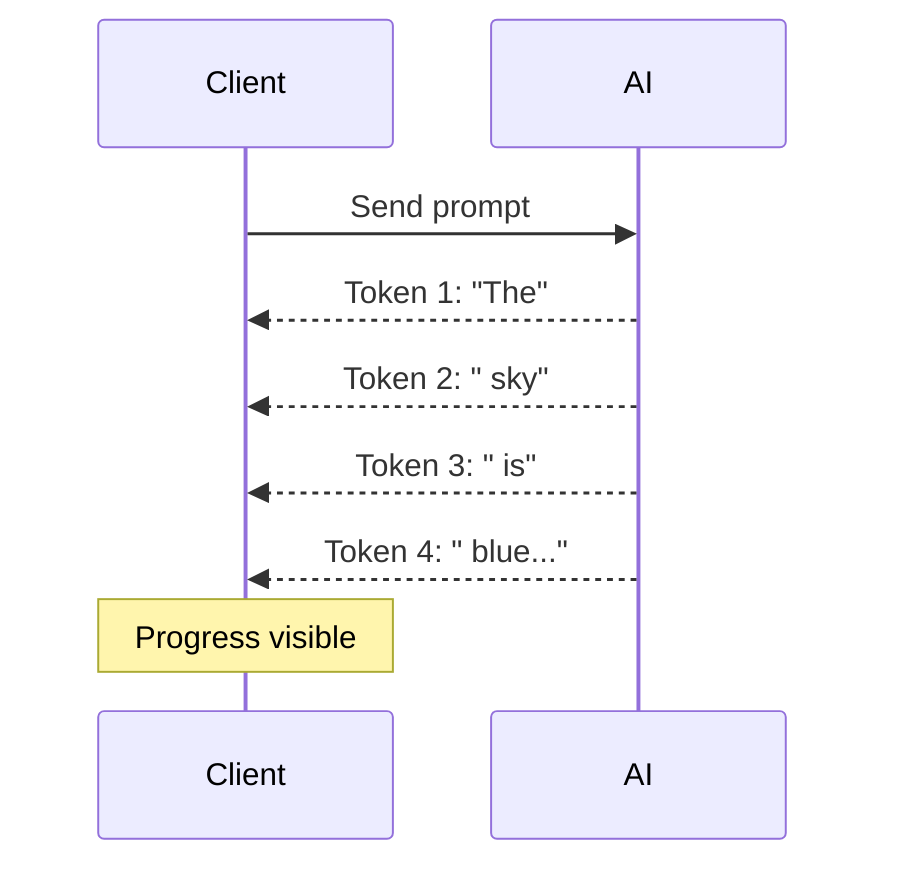
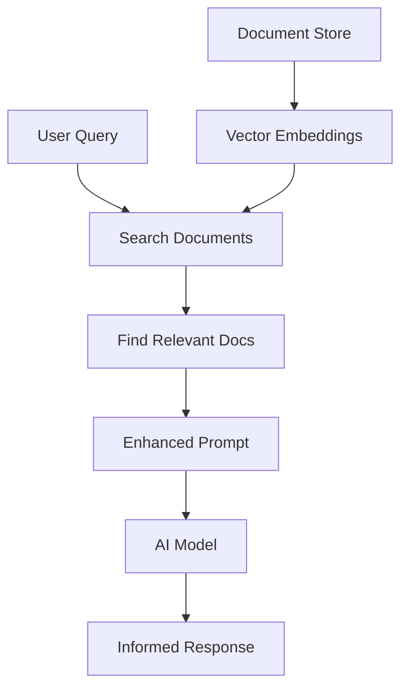
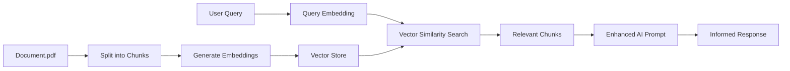

# AI Java Labs: Building Intelligent Java Applications

<div class="pt-12">
  <span @click="$slidev.nav.next" class="px-2 py-1 rounded cursor-pointer" hover="bg-white bg-opacity-10">
    From HTTP fundamentals to advanced RAG systems <carbon:arrow-right class="inline"/>
  </span>
</div>

<div class="abs-br m-6 flex gap-2">
  <button @click="$slidev.nav.openInEditor()" title="Open in Editor" class="text-xl slidev-icon-btn opacity-50 !border-none !hover:text-white">
    <carbon:edit />
  </button>
  <a href="https://github.com/kousen/AiJavaLabs" target="_blank" alt="GitHub" title="Open in GitHub"
    class="text-xl slidev-icon-btn opacity-50 !border-none !hover:text-white">
    <carbon-logo-github />
  </a>
</div>

---

# Contact Info

Ken Kousen<br>
Kousen IT, Inc.

- ken.kousen@kousenit.com
- http://www.kousenit.com
- http://kousenit.org (blog)
- Social Media:
  - [@kenkousen](https://twitter.com/kenkousen) (Twitter)
  - [@kousenit.com](https://bsky.app/profile/kousenit.com) (Bluesky)
  - [https://www.linkedin.com/in/kenkousen/](https://www.linkedin.com/in/kenkousen/) (LinkedIn)
- *Tales from the jar side* (free newsletter)
  - https://kenkousen.substack.com
  - https://youtube.com/@talesfromthejarside

---

# What You'll Learn: Core Skills

<v-clicks>

- **HTTP Fundamentals**: Raw API integration patterns
- **<span style="color: #00D4FF">LangChain4j</span> Framework**: High-level AI abstractions
- **Text Generation**: OpenAI and Ollama models
- **Streaming Responses**: Real-time token-by-token output

</v-clicks>

<!-- Presenter notes: Emphasize dual approach - understanding both raw HTTP and frameworks -->

---

# What You'll Learn: Advanced Capabilities

<v-clicks>

- **Multimodal AI**: Vision, audio, and image generation
- **RAG Systems**: Document-based question answering
- **Cost Management**: Efficient testing and model selection
- **Modern Java**: Records, sealed interfaces, pattern matching, virtual threads

</v-clicks>

---

# Repository Structure

```bash {maxHeight:'350px'}
AiJavaLabs/
├── labs.md                    # Progressive lab exercises
├── slides.md                  # This presentation
├── build.gradle.kts           # Dependencies & test categories
└── src/
    ├── main/java/com/kousenit/
    │   ├── demos/             # 9+ live demo classes
    │   ├── *Service.java      # Core implementations
    │   └── *Records.java      # Data models
    └── test/                  # Comprehensive test suite
```

<v-clicks>

- **9+ Live Demos**: Ready-to-run examples for each topic
- **Cost-Controlled Testing**: Free local tests, cheap API tests
- **Modern Java 21**: Records, sealed interfaces, pattern matching, virtual threads
- **Dual Learning Path**: Raw HTTP + LangChain4j frameworks

</v-clicks>

---
layout: two-cols
---

# Demo Map: Core Demos

## **Demos 1-6**

1. **TextToSpeechDemo** - Raw HTTP audio
2. **OpenAiService** - Model discovery + JSON
3. **LocalOllamaDemo** - Local AI models
4. **OllamaService** - Sealed interfaces
5. **QuickChatDemo** - LangChain4j chat
6. **MultiModelDemo** - Compare providers

::right::

## **Run Commands**

```bash
# Pattern
./gradlew run -PmainClass=com.kousenit.demos.DemoName

# Quick start
./gradlew run -PmainClass=com.kousenit.demos.QuickChatDemo
```

**Prerequisites:**
- `OPENROUTER_API_KEY` environment variable (QuickChat, MultiModel)
- `OPENAI_API_KEY` environment variable (other OpenAI demos)
- Ollama installed for local demos

---
layout: two-cols
---

# Demo Map: Advanced Demos

## **Demos 7-12**

7. **ToolCallingDemo** - Java methods as tools
8. **StructuredOutputDemo** - Records from model output
9. **StreamingDemo** - Real-time responses
10. **ApiComparisonDemo** / **ResponsesApiDemo**
11. **EasyRAGDemo** - Document Q&A
12. **DecisionModelDemo** - Typed answers with probabilities

::right::

## **Key Concepts**

<v-clicks>

- **Tool Calling**: Model-selected Java methods
- **Streaming**: Token-by-token output
- **API Comparison**: HTTP vs Framework
- **JSON Parsing**: Records and JsonNode navigation
- **RAG**: Document-powered AI

</v-clicks>

---

# Course Philosophy: Understanding Both Levels

<div class="grid grid-cols-2 gap-8">

<div>

## **Why Learn Raw HTTP First?**

<v-clicks>

- **<span style="color: #00D4FF">True Understanding</span>**: Know what frameworks do under the hood
- **<span style="color: #00D4FF">Debugging Skills</span>**: When frameworks fail, you can troubleshoot
- **<span style="color: #00D4FF">Flexibility</span>**: Not locked into any single framework
- **<span style="color: #00D4FF">Performance</span>**: Optimize for your specific needs

</v-clicks>

</div>

<div>

## **Then Master Frameworks**

<v-clicks>

- **<span style="color: #00D4FF">Productivity</span>**: LangChain4j handles boilerplate
- **<span style="color: #00D4FF">Best Practices</span>**: Proven patterns and abstractions
- **<span style="color: #00D4FF">Advanced Features</span>**: RAG, streaming, memory
- **<span style="color: #00D4FF">Rapid Development</span>**: Focus on business logic

</v-clicks>

</div>

</div>

<v-click>



</v-click>

---

# Prerequisites

<div class="grid grid-cols-2 gap-8">

<div>

## Technical Requirements

<v-clicks>

- **Java 21+** (Records, sealed interfaces, pattern matching)
- **Gradle 8.4+** (Kotlin DSL, test categories)
- **<span style="color: #00D4FF">LangChain4j 1.23.0</span>** (current pinned framework)
- **Git** for repository management
- **Ollama** (optional, for local AI models)

</v-clicks>

</div>

<div>

## Environment Setup

```bash
# Required API keys
export OPENROUTER_API_KEY=your_key  # one key for OpenAI, Gemini, and more
export OPENAI_API_KEY=your_key
# Optional providers used in demos/tests
export GOOGLEAI_API_KEY=your_key
export PERPLEXITY_API_KEY=your_key
export ANTHROPIC_API_KEY=your_key    # models lab, other vendors
export ELEVENLABS_API_KEY=your_key   # optional text-to-speech lab

# Optional: Local AI models
curl -fsSL https://ollama.com/install.sh | sh
ollama pull gemma4  # Multimodal: text + vision

# Clone and start
git clone <repo-url>
./gradlew build
./gradlew testDemo  # Quick validation

# Slides
npm install
npx slidev slides.md
# Export to PDF (requires Playwright)
npx slidev export slides.md
```

</div>

</div>

---

# Cost Management Strategy

<div class="grid grid-cols-3 gap-6">

<div>

## **Test Categories**

<v-clicks>

- `@Tag("local")` - **Free** Ollama tests
- `@Tag("cheap")` - **Low-cost** nano models
- `@Tag("demo")` - **Fast** live demos
- `@Tag("expensive")` - **Avoided** by default

</v-clicks>

</div>

<div>

## **Gradle Tasks**

```bash
./gradlew testLocal      # $0
./gradlew testCheap      # ~$0.01
./gradlew testDemo       # ~$0.05
./gradlew testNotExpensive
./gradlew testOpenAI
```

</div>

<div>

## **Model Costs (Approximate; subject to change)**

<v-clicks>

- **<span style="color: #00D4FF">gpt-5-nano</span>**: very low per-token cost
- **<span style="color: #00D4FF">gemma4 (local)</span>**: Free with Ollama (Google's open-source multimodal model)
- **<span style="color: #00D4FF">gpt-image-2.5-flare</span>**: fast GPT Image model (sunburst for precise edits)
- **<span style="color: #00D4FF">gpt-4o-mini-tts</span>**: low cost per minute of audio

</v-clicks>

</div>

</div>

<v-click>

**Smart Strategy**: Develop with free local models, deploy with optimal cloud models

</v-click>

---
layout: section
---

# Demo 1-2: HTTP Fundamentals
## Understanding Raw API Integration

---

# Demo 1: Text-to-Speech with Raw HTTP

````md magic-move
```java
// Raw HTTP approach - Understanding the fundamentals
public class TextToSpeechService {
    private static final String OPENAI_API_KEY = System.getenv("OPENAI_API_KEY");
    private static final HttpClient client = HttpClient.newHttpClient();

    public Path generateMp3(String model, String input, String voice) {
        // TODO: How do we construct the request?
    }
}
```

```java
// Step 1: Create JSON payload manually
String payload = """
    {
        "model": "%s",
        "input": "%s",
        "voice": "%s"
    }
    """.formatted(model, input.replaceAll("\\s+", " ").trim(), voice);
```

```java
// Step 2: Build HTTP request with proper headers
HttpRequest request = HttpRequest.newBuilder()
    .uri(URI.create("https://api.openai.com/v1/audio/speech"))
    .header("Authorization", "Bearer %s".formatted(OPENAI_API_KEY))
    .header("Content-Type", "application/json")
    .header("Accept", "audio/mpeg")
    .POST(HttpRequest.BodyPublishers.ofString(payload))
    .build();
```

```java
// Step 3: Complete implementation with file handling
public Path generateMp3(String model, String input, String voice) {
    String payload = """
        {
            "model": "%s",
            "input": "%s",
            "voice": "%s"
        }
        """.formatted(model, input.replaceAll("\\s+", " ").trim(), voice);

    HttpRequest request = HttpRequest.newBuilder()
        .uri(URI.create("https://api.openai.com/v1/audio/speech"))
        .header("Authorization", "Bearer %s".formatted(OPENAI_API_KEY))
        .header("Content-Type", "application/json")
        .header("Accept", "audio/mpeg")
        .POST(HttpRequest.BodyPublishers.ofString(payload))
        .build();

    try {
        HttpResponse<Path> response =
            client.send(request, HttpResponse.BodyHandlers.ofFile(getFilePath()));
        return response.body();
    } catch (IOException | InterruptedException e) {
        throw new RuntimeException(e);
    }
}
```
````

**Live Demo**: Run `TextToSpeechDemo.java` to hear generated audio! 🎵

---

# Demo 2: Model Discovery & JSON Parsing

````md magic-move
```java
// Understanding API responses with Java records
public class OpenAiRecords {
    public record ModelList(List<Model> data) {
        public record Model(
                String id,
                long created,
                @JsonProperty("owned_by") String ownedBy) {
        }
    }
}
```

```java
// Service implementation with Jackson 3 (tools.jackson)
public class OpenAiService {
    private static final HttpClient client = HttpClient.newHttpClient();
    private final ObjectMapper mapper = JsonMapper.builder()   // immutable, built once
            .propertyNamingStrategy(PropertyNamingStrategies.SNAKE_CASE)
            .build();

    public ModelList listModels() throws IOException, InterruptedException {
        HttpRequest request = HttpRequest.newBuilder()
            .uri(URI.create("https://api.openai.com/v1/models"))
            .header("Authorization", "Bearer " + System.getenv("OPENAI_API_KEY"))
            .GET()
            .build();

        HttpResponse<String> response = client.send(request,
                HttpResponse.BodyHandlers.ofString());
        return mapper.readValue(response.body(), ModelList.class);  // unchecked exceptions
    }
}
```
````

**Key Learning**: Records + Jackson data binding give you type-safe API responses; unmapped fields are ignored

---

# JSON Parsing: Records vs Tree Model

<div class="grid grid-cols-2 gap-4">

<div>

## **Records (data binding)**

```java
// The shape is known: bind it
ModelList models = mapper.readValue(
        response.body(), ModelList.class);

models.data().stream()
      .map(ModelList.Model::id)
      .forEach(System.out::println);
```

<v-click>

- One line, type-safe
- Unknown fields are ignored
- The default for every lab

</v-click>

</div>

<div>

## **JsonNode (tree model)**

```java
// The shape varies: walk it
JsonNode root = mapper.readTree(response.body());

for (JsonNode item : root.path("output")) {
    if ("message".equals(item.path("type").asString())) {
        String text = item.at("/content/0/text").asString();
    }
}
```

<v-click>

- Responses API: `reasoning`, `web_search_call`, `message` items in varying order
- `path()` and `at()` return a missing node, never throw
- Use it to explore an API before you write the records

</v-click>

</div>

</div>

---

# JSON Pointer: Elegant Deep Navigation

## **RFC 6901 JSON Pointer Syntax**

<v-clicks>

- **Direct path access**: `/output/0/content/0/text`
- **Array indexing**: Use numbers for array elements
- **Nested objects**: Chain with `/` separator

</v-clicks>

<v-click>

```java
// Complex nested structure navigation - one line!
JsonNode root = mapper.readTree(response.body());

// Instead of multiple loops and null checks:
String text = root.at("/data/results/0/attributes/name").asText();

// With fallback:
String value = root.at("/missing/path").asText("default");
```


### **Which library?**

- **Jackson 3** (`tools.jackson`): this course and Spring Boot 4. Immutable mappers, unchecked exceptions, `java.time` built in
- **Jackson 2** (`com.fasterxml.jackson`): still inside LangChain4j; coexists because the package differs
- **Gson**: works, but its README says maintenance mode
- **JEP 540**: a Simple JSON API in the JDK, incubating, targeted at JDK 28

</v-click>

---

# HTTP vs Framework Comparison

<div class="grid grid-cols-2 gap-8">

<div>

## **Raw HTTP Approach**

```java
// Manual request construction
HttpRequest request = HttpRequest.newBuilder()
    .uri(URI.create(url))
    .header("Authorization", "Bearer " + key)
    .header("Content-Type", "application/json")
    .POST(HttpRequest.BodyPublishers.ofString(
        mapper.writeValueAsString(payload)))
    .build();

// Manual response handling
HttpResponse<String> response =
    client.send(request, HttpResponse.BodyHandlers.ofString());
return mapper.readValue(response.body(), ResponseClass.class);
```

</div>

<div>

## **<span style="color: #00D4FF">LangChain4j</span> Framework**

```java
// High-level abstraction
ChatModel model = OpenAiChatModel.builder()
        .apiKey(System.getenv("OPENAI_API_KEY"))
        .modelName("gpt-5-nano")
        .build();

// Simple method call
String response = model.chat("Hello, world!");
```

</div>

</div>

<v-click>

**Both are valuable**: Raw HTTP for understanding, frameworks for productivity

</v-click>

---

# Raw HTTP: When the Request Fails

HTTP status codes are not exceptions. A 401 or 429 still returns a body, and that body is the provider's error envelope, not the JSON you modeled.

```java
// Shared by every service: check first, then bind
public static HttpResponse<String> requireSuccess(HttpResponse<String> response) {
    int status = response.statusCode();
    if (status / 100 == 2) return response;

    String retryAfter = response.headers().firstValue("Retry-After")   // sent with 429
            .map(s -> " (Retry-After: %ss)".formatted(s)).orElse("");
    throw new ApiException(status, "HTTP %d from %s: %s%s".formatted(
            status, response.uri(), errorMessage(response.body()), retryAfter));
}

// errorMessage: JsonNode.at("/error/message"), or the raw body when there is no envelope
```

<v-clicks>

- **OpenAI, OpenRouter, Anthropic**: `{"error": {"message": ...}}`. **Ollama**: `{"error": "..."}`. Read the docs, then handle both
- **`ofFile` handlers save the error too**: a 401 text-to-speech call produces an mp3 full of JSON
- **Timeouts**: `HttpClient.newBuilder().connectTimeout(...)` and `HttpRequest.newBuilder(uri).timeout(...)`
- **Retries**: on 429 and 5xx only, honor `Retry-After`, add jitter, cap attempts, retry idempotent calls

</v-clicks>

---

# Services Without a Java SDK

Same pattern, three vendors. Only the headers and the JSON change.

<div class="grid grid-cols-3 gap-4 text-sm">

<div>

**OpenRouter catalog** (no key)
```java
HttpRequest.newBuilder()
  .uri(URI.create(MODELS_URL
      + "?output_modalities=image"))
  .header("Accept", "application/json")
  .build();
```
Richer JSON than OpenAI's list: modalities and per-token prices, bound to records with a `promptPerMillion()` method

</div>

<div>

**Anthropic** (`x-api-key`)
```java
HttpRequest.newBuilder()
  .uri(URI.create(MODELS_URL))
  .header("x-api-key", API_KEY)
  .header("anthropic-version",
          "2023-06-01")
  .build();
```
`created_at` binds straight to `java.time.Instant`

</div>

<div>

**ElevenLabs** (`xi-api-key`)
```java
HttpRequest.newBuilder()
  .uri(URI.create(BASE + "/text-to-speech/"
      + voiceId))
  .header("xi-api-key", API_KEY)
  .header("Accept", "audio/mpeg")
  .POST(ofString(mapper.writeValueAsString(
      new SpeechRequest(text, model))))
  .build();
```
Python and JS SDKs only. Doesn't matter.

</div>

</div>

<v-click>

**The argument**: the next service you need will not have a Java library either. `HttpClient` + records + a mapper is the library.

</v-click>

---
layout: section
---

# Demo 3-4: Local AI with Ollama
## Privacy-First AI Integration

---

# Demo 3: Ollama Setup and Architecture

## **Why Ollama?**

<v-clicks>

- **<span style="color: #00D4FF">Privacy</span>**: No data leaves your machine
- **<span style="color: #00D4FF">Cost</span>**: Zero API costs after setup
- **<span style="color: #00D4FF">Control</span>**: Full model customization
- **<span style="color: #00D4FF">Speed</span>**: Local inference, no network delays

</v-clicks>

<div class="mt-4">



</div>

<v-click>

**Setup Commands**:
```bash
ollama pull gemma4        # Multimodal: text + vision (Google open-source)
ollama serve              # Start server (automatic on install)
```

</v-click>

---

# Demo 4: Modern Java with Sealed Interfaces

````md magic-move
```java
// Step 1: Model different request types with records
public class OllamaRecords {
    public record OllamaTextRequest(
            String model,
            String prompt,
            boolean stream) {}

    public record OllamaVisionRequest(
            String model,
            String prompt,
            boolean stream,
            List<String> images) {}
}
```

```java
// Step 2: Use sealed interfaces for type safety (Java 17+)
public sealed interface OllamaRequest
    permits OllamaTextRequest, OllamaVisionRequest {}

public record OllamaTextRequest(
        String model, String prompt, boolean stream)
        implements OllamaRequest {}

public record OllamaVisionRequest(
        String model, String prompt, boolean stream, List<String> images)
        implements OllamaRequest {

    // Compact constructor with Base64 encoding
    public OllamaVisionRequest {
        images = images.stream()
                .map(this::encodeImage)
                .collect(Collectors.toList());
    }
}
```

```java
// Step 3: Pattern matching with switch expressions (Java 21)
public OllamaResponse generate(OllamaRequest request) {
    switch (request) {
        case OllamaTextRequest textRequest -> {
            logger.log(INFO, "Text request: {0}", textRequest.prompt());
        }
        case OllamaVisionRequest visionRequest -> {
            logger.log(INFO, "Vision request with {0} images",
                visionRequest.images().size());
        }
        // Exhaustive - no default needed with sealed types!
    }

    // Same HTTP logic for both request types
    return sendRequest(request);
}
```
````

**Modern Java Benefits**: Type safety, exhaustive pattern matching, compact constructors

---
layout: section
---

# Demo 5-6: Framework Integration
## <span style="color: #00D4FF">LangChain4j</span> Power and Simplicity

---

# Demo 5: Quick Chat with <span style="color: #00D4FF">LangChain4j</span>

````md magic-move
```java
// From 50+ lines of HTTP code to this:
import dev.langchain4j.model.chat.ChatModel;
import dev.langchain4j.model.openai.OpenAiChatModel;

public class QuickChatDemo {
    public static void main(String[] args) {
        // TODO: How do we create a chat model?
    }
}
```

```java
// Step 1: Build the model with fluent API
// OpenRouter speaks the OpenAI API, so only the base URL, key, and model id change
ChatModel model = OpenAiChatModel.builder()
        .baseUrl("https://openrouter.ai/api/v1")
        .apiKey(System.getenv("OPENROUTER_API_KEY"))
        .modelName("openai/gpt-5-nano")
        .logRequests(false)  // Toggle for debugging
        .logResponses(false) // Toggle for debugging
        .build();
```

```java
// Step 2: Complete implementation - just one method call!
public class QuickChatDemo {
    public static void main(String[] args) {
        ChatModel model = OpenAiChatModel.builder()
                .baseUrl("https://openrouter.ai/api/v1")
                .apiKey(System.getenv("OPENROUTER_API_KEY"))
                .modelName("openai/gpt-5-nano")
                .build();

        String prompt = "Explain what LangChain4j is in 2-3 sentences.";
        System.out.println("Answer: " + model.chat(prompt));
    }
}
```
````

**Live Demo**: Run `QuickChatDemo.java` - from complex HTTP to simple method call!

---

# Demo 6: Multi-Model Provider Support

````md magic-move
```java
// Step 1: OpenAI's gpt-5-nano, reached through OpenRouter
ChatModel openai = OpenAiChatModel.builder()
        .baseUrl("https://openrouter.ai/api/v1")
        .apiKey(System.getenv("OPENROUTER_API_KEY"))
        .modelName("openai/gpt-5-nano")
        .build();

String response = openai.chat("What is the capital of France?");
System.out.println("OpenAI: " + response);
```

```java
// Step 2: Different MODEL, same client - only the model id changes
// (OpenRouter speaks the OpenAI protocol, so this is still OpenAiChatModel)
ChatModel gemini = OpenAiChatModel.builder()
        .baseUrl("https://openrouter.ai/api/v1")
        .apiKey(System.getenv("OPENROUTER_API_KEY"))
        .modelName("google/gemini-3-flash-preview")
        .build();

String response = gemini.chat("What is the capital of France?");
System.out.println("Gemini: " + response);
```

```java
// Step 3: Different CLIENT, same interface - LangChain4j's ChatModel
ChatModel ollama = OllamaChatModel.builder()
        .baseUrl("http://localhost:11434")
        .modelName("gemma4")
        .build();

String response = ollama.chat("What is the capital of France?");
System.out.println("Ollama: " + response);
```
````

**Two layers of portability**: OpenRouter makes step 1 → 2 a model-id change. LangChain4j's `ChatModel` interface makes step 3 a one-class swap. The code that calls `chat()` never changes.

---

# Fan Out on Virtual Threads

Every `chat()` call blocks on the network. That is the work virtual threads were built for.

```java
Map<String, ChatModel> models = Map.of(
        "gpt-5-nano", openRouter("openai/gpt-5-nano"),
        "gemini",     openRouter("google/gemini-3-flash-preview"),
        "gemma4",     ollama("gemma4"));

Map<String, Future<String>> answers = new LinkedHashMap<>();
try (var executor = Executors.newVirtualThreadPerTaskExecutor()) {
    models.forEach((name, model) ->
            answers.put(name, executor.submit(() -> model.chat(question))));
}   // close() waits for every task

answers.forEach((name, future) ->
        System.out.printf("%s: %s%n", name, future.resultNow()));
```

<v-clicks>

- **The model code did not change**: `chat()` still blocks; the virtual thread parks while it waits
- **No pool to size**: one thread per call, three or three hundred
- **Wall time ≈ the slowest call** instead of the sum
- **Same shape for every fan-out**: many models, many documents, a batch of embeddings

</v-clicks>

**Live Demo**: `MultiModelDemo` runs the sequential and concurrent versions back to back and prints both timings.

---

# Provider Ecosystem

<div class="grid grid-cols-3 gap-6">

<div>

## **Cloud Providers**

<v-clicks>

- **OpenAI** • gpt-5-nano, GPT Image
- **OpenRouter** • One key, many providers (OpenAI-compatible API)
- **Perplexity** • Sonar (OpenAI-compatible API)
- **Google AI** • Gemini models
- **Anthropic** • Claude models
- **Azure OpenAI** • Enterprise GPT
- **AWS Bedrock** • Multiple models

</v-clicks>

</div>

<div>

## **Local Models**

<v-clicks>

- **Ollama** • gemma4, llama3.1, mistral
- **Hugging Face** • Open source models
- **vLLM** • High-performance inference
- **LocalAI** • OpenAI-compatible API

</v-clicks>

</div>

<div>

## **Specialized Services**

<v-clicks>

- **Vision** • gemma4, LLaVA
- **Audio** • Whisper, OpenAI TTS, ElevenLabs (raw HTTP)
- **Embeddings** • sentence-transformers
- **Code** • CodeLlama, StarCoder

</v-clicks>

</div>

</div>

<v-click>

**<span style="color: #00D4FF">LangChain4j</span> Advantage**: Switch providers with just configuration changes!

</v-click>

---
layout: section
---

# Demo 7: Tool Calling
## Let the Model Call Java Code

---

# Tool Calling with LangChain4j

````md magic-move
```java
// Ordinary Java methods become tools
public class TravelTools {
    @Tool("Get a small weather summary for a city")
    public String weather(@P("city name") String city) {
        return "%s: %d F and %s".formatted(city, temp, summary);
    }
}
```

```java
// Define the assistant interface
interface TravelAssistant {
    @SystemMessage("""
        Use the provided Java tools whenever the user asks
        about weather, distance, drive time, or travel cost.
        """)
    String chat(String message);
}
```

```java
// Register tools with the AI service
TravelAssistant assistant = AiServices.builder(TravelAssistant.class)
        .chatModel(model)
        .tools(new TravelTools())
        .build();

String answer = assistant.chat("""
    I am driving from Hartford to Boston.
    What is the weather like at both ends,
    how far is it, and what will fuel cost?
    """);
```
````

**Key idea**: The model chooses when to call a tool; Java still owns validation, side effects, and business rules.

---

# Tool Calling: What's on the Wire

`.logRequests(true)` shows the loop LangChain4j runs for you. Three HTTP exchanges:

<div class="grid grid-cols-2 gap-4 text-sm">

<div>

**1. Request: your methods as JSON Schema**
```json
"tools": [{ "type": "function", "function": {
  "name": "drivingDistance",
  "description": "Estimate driving distance ...",
  "parameters": { "type": "object",
    "properties": { "from": {"type": "string"},
                    "to":   {"type": "string"} },
    "required": ["from", "to"] } } }, ...]
```

**1. Response: no answer, a request to call**
```json
"message": { "role": "assistant", "content": null,
  "tool_calls": [{ "id": "call_NqbU...",
    "function": { "name": "drivingDistance",
      "arguments": "{\"from\":\"Hartford\",\"to\":\"Boston\"}" }}]},
"finish_reason": "tool_calls"
```

</div>

<div>

**2. Request: Java ran it, results go back by id**
```json
{ "role": "assistant", "tool_calls": [ ... ] },
{ "role": "tool", "tool_call_id": "call_NqbU...",
  "content": "102" }
```

**3. Response: prose, once the model has the data**
```json
"message": { "role": "assistant",
  "content": "Hartford to Boston is about 102 miles ..." },
"finish_reason": "stop"
```

<v-clicks>

- The model emits JSON; **your code executes**
- The loop is send, check `finish_reason`, run, append, send
- Arguments are strings the model composed: validate them

</v-clicks>

</div>

</div>

---

# Tool Calling Guardrails

<v-clicks>

- Keep tools small, named clearly, and easy to explain
- Validate all tool arguments before doing real work
- Avoid dangerous side effects in first-pass tools
- Log tool name, arguments, result, and failure separately
- Treat tool outputs as data, not as proof the model reasoned correctly

</v-clicks>

```bash
./gradlew run -PmainClass=com.kousenit.demos.ToolCallingDemo
```

---

# Demo 8: Structured Output Extraction

````md magic-move
```java
// The application wants data, not prose
public enum Priority { LOW, MEDIUM, HIGH }

public record CourseInquiry(
        String topic,
        Priority priority,
        boolean needsFollowUp,
        List<String> actionItems) {}
```

```java
// AI Service returns the record directly
interface InquiryExtractor {
    CourseInquiry extract(String message);
}
```

```java
// Enable JSON Schema support for the model
ChatModel model = OpenAiChatModel.builder()
        .apiKey(System.getenv("OPENAI_API_KEY"))
        .modelName("gpt-5-nano")
        .supportedCapabilities(RESPONSE_FORMAT_JSON_SCHEMA)
        .strictJsonSchema(true)
        .build();
```

```java
InquiryExtractor extractor = AiServices.builder(InquiryExtractor.class)
        .chatModel(model)
        .build();

CourseInquiry inquiry = extractor.extract(studentMessage);
validate(inquiry);
```
````

**Key idea**: Structured output turns model interpretation into Java data, but your application still validates the result.

```bash
./gradlew run -PmainClass=com.kousenit.demos.StructuredOutputDemo
```

---

# Beyond Text: Decision Models

LangChain4j 1.23 adds an **experimental** `DecisionModel` API: typed questions in, probabilities out. Nothing to parse.

````md magic-move
```java
// Step 1: TypeSafe's Jev decision model, reached through OpenRouter
DecisionModel model = TypeSafeDecisionModel.builder()
        .baseUrl("https://openrouter.ai/api")   // same key as the chat demos
        .apiKey(System.getenv("OPENROUTER_API_KEY"))
        .modelName("typesafe/jev-1.13")
        .build();

DecisionRequest request = DecisionRequest.builder()
        .input(inquiry)
        .question("course", ChoiceQuestion.builder()
                .text("Which course does the inquiry ask about?")
                .option("java", "Core Java, migrations between versions")
                .option("spring", "Spring Framework and Spring Boot")
                .option("ai", "AI models and APIs in Java applications")
                .option("other", "Anything else")
                .build())
        .question("follow_up",
                YesNoQuestion.from("Does the sender ask for a quote, a date, or a call?"))
        .build();
```

```java
// Step 2: Every option comes back with a probability. Thresholds live in Java.
DecisionResponse response = model.decide(request);

ChoiceAnswer course = response.choice("course");
course.value();          // "java"
course.probabilities();  // {java=1.0, spring=0.0, ai=0.0, other=0.0}

if (course.margin() < 0.2) {                       // top two options too close
    routeToHuman(inquiry);
}
if (response.yesNo("follow_up").isYes(0.7)) {      // tune per model
    replyToday(inquiry);
}
```
````

**Key idea**: Structured output gives you one answer. A decision model tells you how sure it is about every option.

```bash
./gradlew run -PmainClass=com.kousenit.demos.DecisionModelDemo
```

---
layout: section
---

# Demo 9: Streaming Responses
## Real-Time AI

---

# Streaming with the JDK: sendAsync + ofLines

No library needed: the JDK client delivers the body as it arrives

```java
public String generateStreaming(String model, String prompt, Consumer<String> onToken) {
    var request = HttpRequest.newBuilder()
            .uri(URI.create(URL + "/api/generate"))
            .header("Content-Type", "application/json")
            .POST(BodyPublishers.ofString(mapper.writeValueAsString(
                    new OllamaTextRequest(model, prompt, true))))
            .build();

    return client.sendAsync(request, HttpResponse.BodyHandlers.ofLines())  // CompletableFuture
            .thenApply(HttpSupport::requireSuccessLines)
            .thenApply(response -> {
                var text = new StringBuilder();
                response.body()                                              // Stream<String>, live
                        .map(line -> mapper.readValue(line, OllamaResponse.class))
                        .forEach(chunk -> { onToken.accept(chunk.response()); text.append(chunk.response()); });
                return text.toString();
            })
            .join();                                                        // or return the future
}
```

<v-clicks>

- **Ollama**: one JSON object per line. **OpenAI**: server-sent events, `data: {...}` lines ending in `data: [DONE]`
- **`join()`** blocks for a `main` or a test; a server returns the future instead
- This is the shape every framework's streaming handler wraps

</v-clicks>

---

# Demo 9: Clean Streaming with Lambda Handlers

````md magic-move
```java
// Old way: Complex anonymous inner classes
public void oldStreamingApproach() {
    model.chat("Tell me a story", new StreamingChatResponseHandler() {
        @Override
        public void onPartialResponse(String token) {
            System.out.print(token);
        }

        @Override
        public void onError(Throwable error) {
            System.err.println("Error: " + error);
        }

        @Override
        public void onCompleted() {
            System.out.println("\nDone!");
        }
    });
}
```

```java
// LangChain4j utilities: Clean lambda approach
import static dev.langchain4j.model.LambdaStreamingResponseHandler.*;

public class StreamingDemo {
    public static void main(String[] args) {
        var ollama = OllamaStreamingChatModel.builder()
                .baseUrl("http://localhost:11434")
                .modelName("gemma4")
                .build();

        // One-liner for simple streaming.
        // The *Blocking variant waits for the stream, so main does not exit early
        onPartialResponseBlocking(ollama,
            "Tell me a haiku about Java", System.out::print);
    }
}
```

```java
// With error handling - still clean and functional
var openai = OpenAiStreamingChatModel.builder()
        .apiKey(System.getenv("OPENAI_API_KEY"))
        .modelName("gpt-4o-mini")
        .build();

// Handle both tokens and errors elegantly
onPartialResponseAndErrorBlocking(openai, "Why is the sky blue?",
    System.out::print,  // Handle each token
    error -> System.err.println("Error: " + error.getMessage()));

// Inside a server, use the non-blocking onPartialResponse(...) /
// onPartialResponseAndError(...) handlers with model.chat(...) instead
```
````

**Live Demo**: Run `StreamingDemo.java` to see tokens appear in real-time!

---

# Streaming Architecture Benefits

<div class="grid grid-cols-2 gap-4">

<div>

### **User Experience**

<v-clicks>

- **Immediate Feedback**: See progress instantly
- **Perceived Speed**: Feels faster
- **Interruptible**: Stop generation early
- **Engaging**: Watch AI "think"

</v-clicks>

### **Technical Benefits**

<v-clicks>

- **Lower Latency**: First token quickly
- **Better Resources**: Process as arriving
- **Scalability**: Multiple streams
- **Error Recovery**: Graceful failures

</v-clicks>

</div>

<div>



</div>

</div>

---
layout: section
---

# Demo 11: Retrieval-Augmented Generation
## Document-Powered AI

---

# RAG: The Knowledge Problem

<div class="grid grid-cols-2 gap-4">

<div>

### **AI Limitations**

<v-clicks>

- **Knowledge Cutoff**: Training end date
- **No Your Data**: Can't read docs
- **Hallucinations**: Makes up facts
- **Static Info**: No updates

</v-clicks>

### **RAG Solution**

<v-click>

**RAG = Retrieval-Augmented Generation**
Give AI access to YOUR documents!

</v-click>

</div>

<div>



</div>

</div>

---

# RAG Implementation with <span style="color: #00D4FF">LangChain4j</span>

````md magic-move
```java
// Step 1: Load and process documents
import static dev.langchain4j.data.document.loader.FileSystemDocumentLoader.loadDocuments;

List<Document> documents = loadDocuments(
    toPath("documents/"),
    glob("*.txt")
);
```

```java
// Step 2: Create vector store and ingest documents
InMemoryEmbeddingStore<TextSegment> embeddingStore =
    new InMemoryEmbeddingStore<>();

// Magic happens here - documents become searchable vectors
EmbeddingStoreIngestor.ingest(documents, embeddingStore);

ContentRetriever retriever =
    EmbeddingStoreContentRetriever.from(embeddingStore);
```

```java
// Step 3: Create AI assistant with document access
public interface Assistant {
    String chat(String userMessage);
}

Assistant assistant = AiServices.builder(Assistant.class)
        .chatModel(chatModel)
        .chatMemory(MessageWindowChatMemory.withMaxMessages(10))
        .contentRetriever(retriever)  // The magic ingredient!
        .build();
```

```java
// Step 4: Complete EasyRAGDemo implementation
public class EasyRAGDemo {
    public static void main(String[] args) {
        List<Document> documents = loadDocuments(toPath("documents/"), glob("*.txt"));

        ChatModel chatModel = OpenAiChatModel.builder()
                .apiKey(System.getenv("OPENAI_API_KEY"))
                .modelName("gpt-5-nano")
                .build();

        Assistant assistant = AiServices.builder(Assistant.class)
                .chatModel(chatModel)
                .chatMemory(MessageWindowChatMemory.withMaxMessages(10))
                .contentRetriever(createContentRetriever(documents))
                .build();

        // AI can now answer questions about your documents!
        startConversationWith(assistant);
    }
}
```
````

**Live Demo**: Run `EasyRAGDemo.java` - AI answers questions about YOUR documents!

---

# RAG Deep Dive: How It Works

<div class="grid grid-cols-2 gap-8">

<div>

## **Vector Embeddings**

<v-clicks>

- **<span style="color: #00D4FF">Numerical Representation</span>**: Text → vectors (1536+ dimensions)
- **<span style="color: #00D4FF">Semantic Similarity</span>**: Similar meaning = closer vectors
- **<span style="color: #00D4FF">Searchable</span>**: Find relevant content by vector distance

</v-clicks>

</div>

<div>

## **Document Processing**

<v-clicks>

- **<span style="color: #00D4FF">Chunking</span>**: Split documents into manageable pieces
- **<span style="color: #00D4FF">Embedding</span>**: Convert chunks to vectors
- **<span style="color: #00D4FF">Storage</span>**: Index in vector database
- **<span style="color: #00D4FF">Retrieval</span>**: Find most relevant chunks for query

</v-clicks>

</div>

</div>

<v-click>



</v-click>

---

# Advanced Topics Overview

<div class="grid grid-cols-2 gap-8">

<div>

## **Production Considerations**

<v-clicks>

- **<span style="color: #00D4FF">Vector Databases</span>**: Redis, Pinecone, Weaviate
- **<span style="color: #00D4FF">Chunking Strategies</span>**: Token-based, semantic, overlapping
- **<span style="color: #00D4FF">Embedding Models</span>**: OpenAI, sentence-transformers
- **<span style="color: #00D4FF">Hybrid Search</span>**: Vector + keyword search

</v-clicks>

</div>

<div>

## **Integration Patterns**

<v-clicks>

- **<span style="color: #00D4FF">Memory Management</span>**: Conversation history
- **<span style="color: #00D4FF">Multi-Modal RAG</span>**: Text, images, audio
- **<span style="color: #00D4FF">Real-Time Updates</span>**: Dynamic document ingestion
- **<span style="color: #00D4FF">Security</span>**: Access control, data privacy

</v-clicks>

</div>

</div>

---

# Developer Integration Patterns to Explore

<div class="grid grid-cols-2 gap-8">

<div>

## **Tool Calling**

<v-clicks>

- Model-selected Java methods
- Application-owned validation and side effects
- Natural path to APIs, databases, and services
- Demo: `ToolCallingDemo`

</v-clicks>

</div>

<div>

## **Structured Outputs**

<v-clicks>

- Ask for data contracts, not prose, when code consumes the result
- Map JSON output to records or DTOs
- Validate required fields and enum values
- Demo: `StructuredOutputDemo`

</v-clicks>

</div>

</div>

<v-click>

**Why it matters**: Most production AI work is not chat. It is model-assisted control flow around ordinary application code.

</v-click>

---
layout: section
---

# Testing Strategy
## Smart Cost Control and Quality Assurance

---

# Test Categories for Cost Control

<div class="grid grid-cols-2 gap-4">

<div>

### **Test Tags**

```java
@Test
@Tag("local")  // Free
void testOllama() {
    // $0 cost
}

@Test
@Tag("cheap")  // Low cost
void testNano() {
    // ~$0.001
}

@Test
@Tag("demo")   // Fast
void quickDemo() {
    // Optimized
}
```

</div>

<div>

### **Gradle Commands**

```bash
# Free tests only
./gradlew testLocal

# Low-cost tests
./gradlew testCheap

# Demo tests
./gradlew testDemo

# Exclude expensive
./gradlew testNotExpensive
```

<v-click>

**Strategy**: Develop with `testLocal`, validate with `testCheap`

</v-click>

</div>

</div>

---

# Advanced Test Selection

<div class="grid grid-cols-2 gap-8">

<div>

## **Provider-Specific Testing**

```bash
# OpenAI API tests only
./gradlew testOpenAI

# All tests (including expensive)
./gradlew test

# Custom test selection
./gradlew test --tests "*OpenAi*"
```

</div>

<div>

## **Environment Guards**

```java
@Test
@EnabledIfEnvironmentVariable(
    named = "OPENAI_API_KEY",
    matches = ".+")
void testRequiresApiKey() {
    // Only runs if key is set
}
```

</div>

</div>

<v-click>

**Smart Development**: Use free local models for TDD, validate with cloud models before deployment

</v-click>

---

# Testing Patterns for AI Applications

<div class="grid grid-cols-2 gap-8">

<div>

## **Unit Testing Approaches**

```java
@Test
void shouldParseModelList() {
    String json = """
        {"data": [
            {"id": "gpt-4", "created": 123}
        ]}
        """;
    ModelList result = mapper.readValue(json, ModelList.class);
    assertThat(result.data()).hasSize(1);
}

@Test
void shouldHandleApiError() {
    // Test error scenarios
    assertThrows(RuntimeException.class,
        () -> service.generateWithInvalidKey());
}
```

</div>

<div>

## **Integration Testing**

```java
@Test
@Tag("local")
void shouldStreamTokens() {
    List<String> tokens = new ArrayList<>();

    ollamaService.generateStreaming("gemma4",
        "Count from 1 to 5, digits only.",
        tokens::add
    );

    assertThat(tokens).hasSizeGreaterThan(1);
    assertThat(String.join("", tokens))
        .containsSubsequence("1", "2", "3", "4", "5");
}
```

</div>

</div>

---

# Quality Assurance for Non-Deterministic Systems

<v-clicks>

- **<span style="color: #00D4FF">Content Assertions</span>**: Check for key concepts, not exact strings
- **<span style="color: #00D4FF">Structural Validation</span>**: Verify JSON format, required fields
- **<span style="color: #00D4FF">Error Handling</span>**: Test timeout, rate limits, invalid input
- **<span style="color: #00D4FF">Performance Bounds</span>**: Response time, token limits
- **<span style="color: #00D4FF">Cost Monitoring</span>**: Track API usage in tests

</v-clicks>

```java
@Test
@Tag("cheap")
void shouldAnswerSkyColorQuestion() {
    String response = chatModel.chat("Why is the sky blue?");

    // Flexible content assertion
    assertThat(response.toLowerCase())
        .containsAnyOf("scattering", "wavelength", "atmosphere", "light");

    // Structural assertion
    assertThat(response).hasSizeGreaterThan(10);
    assertThat(response).doesNotContain("I don't know");
}
```

---
layout: section
---

# Course Summary
## From HTTP to Intelligent Applications

---

# Your AI Java Journey

<div class="grid grid-cols-2 gap-8">

<div>

## **Foundation Built**

<v-clicks>

- **<span style="color: #00D4FF">HTTP Fundamentals</span>**: Raw API integration patterns
- **<span style="color: #00D4FF">Modern Java</span>**: Records, sealed interfaces, pattern matching, virtual threads
- **<span style="color: #00D4FF">Framework Mastery</span>**: LangChain4j abstractions
- **<span style="color: #00D4FF">Cost Management</span>**: Smart testing strategies

</v-clicks>

</div>

<div>

## **Advanced Capabilities**

<v-clicks>

- **<span style="color: #00D4FF">Multi-Modal AI</span>**: Text, vision, audio integration
- **<span style="color: #00D4FF">Streaming Responses</span>**: Real-time user experiences
- **<span style="color: #00D4FF">RAG Systems</span>**: Document-powered AI
- **<span style="color: #00D4FF">Production Patterns</span>**: Error handling, structured outputs, monitoring

</v-clicks>

</div>

</div>

<v-click>

**Result**: You can build intelligent Java applications with confidence! 🚀

</v-click>

---

# Demo Classes Mastered

<div class="grid grid-cols-2 gap-8">

<div>

### **Core Demos**
- **<span style="color: #00D4FF">QuickChatDemo</span>** - Fast OpenAI integration
- **<span style="color: #00D4FF">TextToSpeechDemo</span>** - Audio generation
- **<span style="color: #00D4FF">LocalOllamaDemo</span>** - Privacy-first AI
- **<span style="color: #00D4FF">MultiModelDemo</span>** - Provider comparison

</div>

<div>

### **Advanced Demos**
- **<span style="color: #00D4FF">StreamingDemo</span>** - Real-time responses
- **<span style="color: #00D4FF">ResponsesApiDemo</span>** - Raw HTTP patterns
- **<span style="color: #00D4FF">ApiComparisonDemo</span>** - Framework vs raw
- **<span style="color: #00D4FF">ToolCallingDemo</span>** - Java methods as tools
- **<span style="color: #00D4FF">StructuredOutputDemo</span>** - Records from model output
- **<span style="color: #00D4FF">DecisionModelDemo</span>** - Typed answers with probabilities
- **<span style="color: #00D4FF">EasyRAGDemo</span>** - Document Q&A

</div>

</div>

<v-click>

**All Ready for Live Demonstration**: Each demo is optimized for training delivery

</v-click>

---

# Key Takeaways: Foundation

<v-clicks>

1. **<span style="color: #00D4FF">Understand Both Levels</span>**: Raw HTTP gives you debugging superpowers, frameworks give you productivity
2. **<span style="color: #00D4FF">Modern Java Shines</span>**: Records and sealed interfaces model the JSON, virtual threads make the blocking calls cheap to run in parallel
3. **<span style="color: #00D4FF">LangChain4j is Powerful</span>**: Unified API across all providers enables true portability

</v-clicks>

---

# Key Takeaways: Best Practices

<v-clicks>

4. **<span style="color: #00D4FF">Cost Management Matters</span>**: Use test categories and local models for development
5. **<span style="color: #00D4FF">RAG Needs Guardrails</span>**: Give AI access to your documents and verify what it retrieves
6. **<span style="color: #00D4FF">Streaming Improves UX</span>**: Real-time responses feel much faster to users
7. **<span style="color: #00D4FF">Contracts Matter</span>**: Use tool calling and structured outputs when code consumes model results
8. **<span style="color: #00D4FF">Test Smart, Not Hard</span>**: Use local models for TDD, cloud models for validation

</v-clicks>

---

# Next Steps: Continue Your AI Journey

<div class="grid grid-cols-2 gap-8">

<div>

## **Hands-On Practice**

<v-clicks>

- **Explore the repository**: Try the demo classes
- **Complete the labs**: Work through the progressive exercises
- **Build custom integrations**: Add your own AI providers
- **Production deployment**: Scale with real applications

</v-clicks>

</div>

<div>

## **Advanced Topics**

<v-clicks>

- **Vector databases**: Redis, Pinecone, Weaviate
- **Multi-agent systems**: Coordinated AI workflows
- **Function calling**: Give AI controlled access to your APIs
- **Structured outputs**: Turn model responses into validated Java data
- **Custom embeddings**: Domain-specific models

</v-clicks>

</div>

</div>

<v-click>

**Resources**:
- [LangChain4j Documentation](https://docs.langchain4j.dev/)
- [Course Repository](https://github.com/kousen/AiJavaLabs)
- [Ollama Models](https://ollama.com/library)

</v-click>

---

# Production Considerations

<div class="grid grid-cols-2 gap-8">

<div>

## **Operational Excellence**

<v-clicks>

- **<span style="color: #00D4FF">API Cost Monitoring</span>**: Track usage across models
- **<span style="color: #00D4FF">Rate Limiting</span>**: Handle quotas gracefully
- **<span style="color: #00D4FF">Error Recovery</span>**: Circuit breakers, retries
- **<span style="color: #00D4FF">Security</span>**: API key management, input validation

</v-clicks>

</div>

<div>

## **Performance Optimization**

<v-clicks>

- **<span style="color: #00D4FF">Model Selection</span>**: Right model for the task
- **<span style="color: #00D4FF">Caching Strategies</span>**: Cache embeddings and responses
- **<span style="color: #00D4FF">Batch Processing</span>**: Optimize API usage
- **<span style="color: #00D4FF">Local Models</span>**: Privacy and cost benefits

</v-clicks>

</div>

</div>

---

# Thank You!

<div class="text-center">

## Questions?

**Kenneth Kousen**
*Java Champion, Author, Speaker*

[kousenit.com](https://kousenit.com) | [@kenkousen](https://twitter.com/kenkousen)

<div class="mt-8 mb-8 text-center">
<div class="text-8xl">🚀</div>
</div>

### Ready to build intelligent Java applications!

**Repository**: [github.com/kousen/AiJavaLabs](https://github.com/kousen/AiJavaLabs)

</div>

<!-- Final presenter notes:
- Emphasize the dual learning approach - HTTP fundamentals + framework mastery
- Highlight the 8 ready-to-run demos for live demonstration
- Point to cost management as a key differentiator
- Encourage hands-on exploration with local models first
- Mention modern Java features as perfect fit for AI APIs
-->
